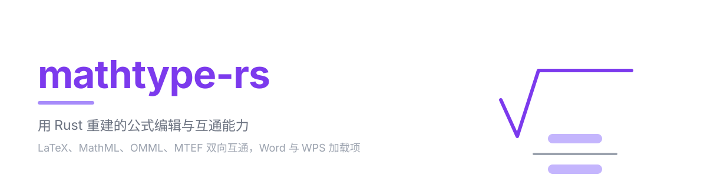
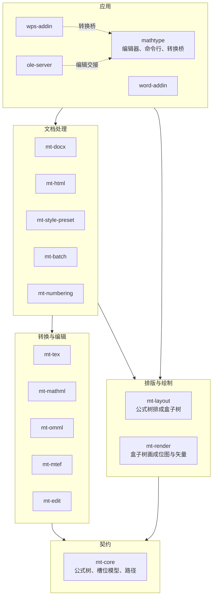
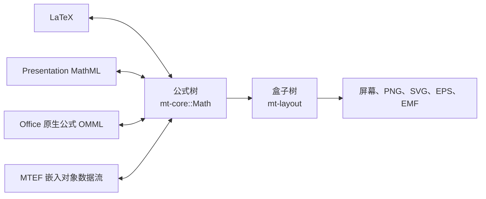
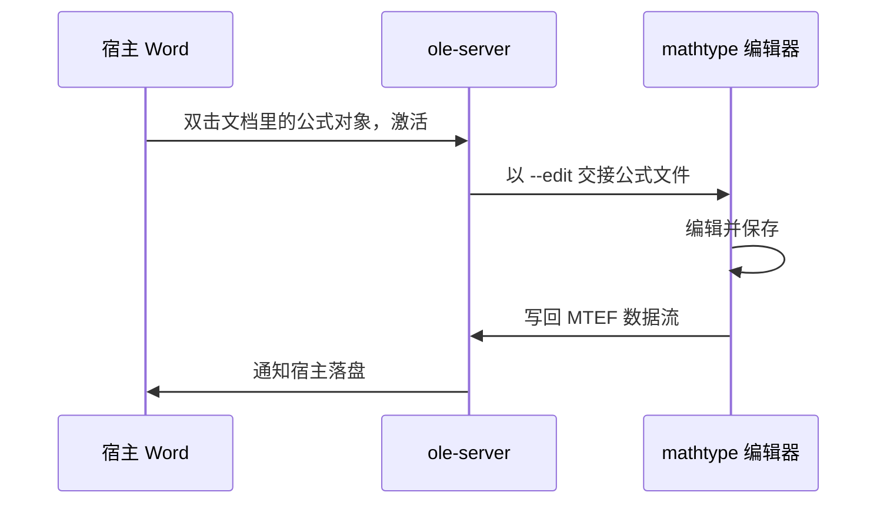
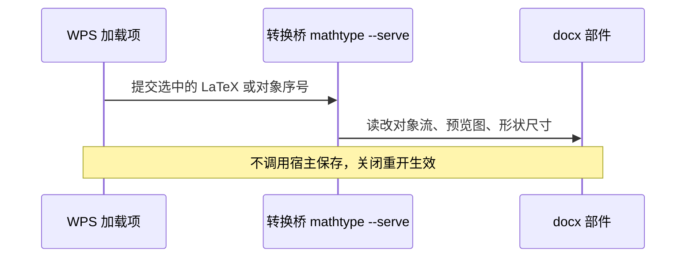
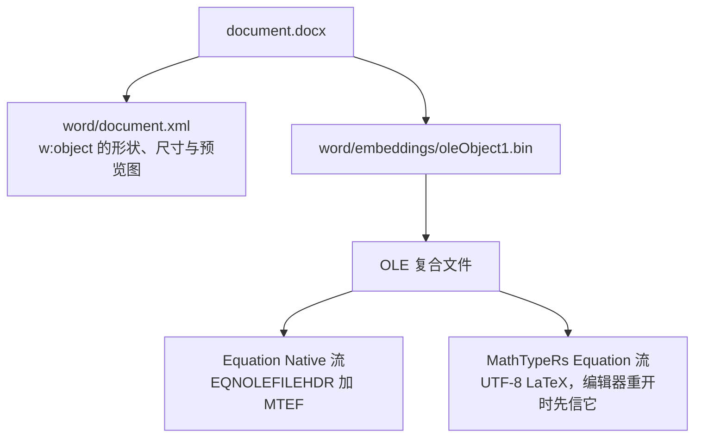

# mathtype-rs



[](https://github.com/ouyangjiahong26/mathtype-rs/actions/workflows/ci.yml)
[](#许可)

用 Rust 重建的公式编辑与互通能力，对标商业公式编辑器 MathType 的功能面与文档互通能力。

## 简介

一篇实际在用的 Word 或 WPS 文档里，公式往往有两种来源：宿主自己的原生公式，以及以嵌入对象形式存的 MathType 公式。用户的两者都要能打开、能编辑、能转换，而 MathType 是闭源商业软件，不提供 Linux 版本，也没有可脚本化的接口，于是把一篇文档里几百条公式转成别的格式只能靠手工。

mathtype-rs 把这条链路整体重做一遍，用好几个可以独立测试的 Rust crate 覆盖它：

- 公式的编辑内核，包含公式树、槽位模型、二维光标导航与撤销栈。
- LaTeX、Presentation MathML、Office 原生公式（OMML）、MTEF 四种格式与公式树的双向转换。
- 排版与绘制分离：排版产出带位置的盒子树，绘制再把它变成屏幕像素、PNG、SVG、EPS 与宿主预览用的 EMF。
- 面向 .docx 的读写、批量转换、公式编号与交叉引用、网页导出。
- 桌面编辑器与 Word、WPS 两个加载项，四个前端共用同一份核心，因此同一棵树在四处排出来的结果一致。

## 当前能力（0.1.1）

| 能力 | 现状 |
| --- | --- |
| 公式模型与编辑内核（`mt-core`、`mt-edit`） | 可用。公式树、按视觉顺序暴露的槽位模型、路径导航、模板插入、二维光标、撤销历史。`mt-core` 不依赖任何第三方 crate，是全部其它 crate 的共同契约。 |
| 格式互通（`mt-tex`、`mt-mathml`、`mt-omml`、`mt-mtef`） | 可用。四种格式都与公式树双向转换。转换器互不调用，需要串联时由上层负责，避免出现隐式转换链。 |
| 排版与绘制（`mt-layout`、`mt-render`） | 可用。盒子树与终端输出格式解耦，同一棵树导出 SVG 与 PNG 的结果由同一套盒子决定。位图之外另提供 EMF 矢量预览。 |
| 文档读写（`mt-docx`） | 可用。轻索引定位段落、公式、嵌入对象与图片，只改需要改的部件，其余部件原样写回。 |
| 批量转换（`mt-batch`） | 可用。清单、导出、替换三种模式，失败逐项记录并回调，不因单条公式失败中断整篇。 |
| 公式编号与交叉引用（`mt-numbering`） | 可用。编号由 Word 域（MACROBUTTON 加 SEQ）生成，引用是指向编号书签的 REF 域，更新域即重排，支持按章与按节复位计数器。 |
| 网页导出（`mt-html`） | 可用。文档结构映射为 HTML，公式为行内 MathML 或 PNG，可选 MathJax 与 KaTeX 脚本，图片写进 `media/` 目录或内嵌为 data URI。 |
| 桌面编辑器（`apps/mathtype`） | 可用。面板插入模板与符号，画布直接编辑，带公式库。同一份二进制还提供命令行与回环 HTTP 转换接口。 |
| 转换桥（`mathtype --serve`） | 可用，只绑定回环地址，随进程退出而结束。给无法启动进程的网页型加载项（WPS）调用同一套转换实现。 |
| 嵌入对象服务器（`apps/ole-server`） | Windows 宿主走 COM 激活路径：双击文档里的公式对象拉起编辑器，保存后写回对象存储。Windows 侧的激活与回写仍在排查中（ADR 0002）。 |
| Word 加载项（`apps/word-addin`） | 原生 COM Ribbon 加载项，只编译于 Windows。提供插入与转换公式的命令。 |
| WPS 加载项（`apps/wps-addin`） | 命令面为 Word 的子集：插入、编辑、转 LaTeX、导出 PNG、批量转换、导出网页、编号与交叉引用。Linux 侧实测宿主不激活第三方 OLE 服务器，因此改走转换桥加文件级编辑（ADR 0003）。加载项完整加载需要用户在 WPS 界面里做一次性授权。 |

跨平台状态：Linux 上桌面编辑器、命令行、转换桥与文档处理全部可用，宿主的进程内对象激活不可用（宿主不支持，见 ADR 0003）。Windows 上另有 COM 加载项与嵌入对象服务器，这一侧的宿主联调仍在进行。

## 架构

设计的第一条约束是把“公式树”做成唯一共享契约：`mt-core` 定义 `Math`、`Node`、`Path` 与全部模板，不依赖任何其它 crate。每个模板按视觉顺序暴露固定长度的槽位序列，编辑、排版、序列化都只走这一个接口，不各自去匹配节点类型。

第二条约束是按数据流向切 crate：格式各自成 crate，排版与绘制分离，编辑模型不依赖图形库，界面与加载项放在 `apps/`。



### 格式互通

四种外部格式各自与公式树双向转换。公式树的节点带原子类与字体信息，因此相邻项的间距、数学字母变体的码位、字号预设都从树上直接读出，不需要转换器各自做排版决定。



### 宿主集成

文档里承载公式分两层。轻量一层是剪贴板与纯文本：写 Office 原生公式与 MathML、LaTeX 文本，不依赖我们的组件也能被宿主识别。完整一层是自己的嵌入对象数据流，保存公式树与样式，重新打开后可以继续编辑。

两个宿主的机制不同，因此主机制选在双方都能走的嵌入对象服务器上，Word 与 WPS 各写一层薄适配。Word 一侧另有原生 COM 加载项：



Linux 上宿主没有 COM 与类注册机制，双击第三方对象时不激活也不报错，进程内这条路走不通。替代方案是把编辑降级到文件级：加载项把文档路径与对象序号交给转换桥，桥直接读写 docx 部件，全程不调用宿主的保存，因此宿主不会重写整篇文档：



### 对象里存了什么

公式对象是一个 OLE 复合文件，作为部件挂在文档里。同一份公式在里面存两遍，一遍给别的公式工具读，一遍给编辑器读：



对象的归属由 ProgID 决定。新建对象默认写 `Equation.3`，传 `Equation.DSMT4` 就写成 MathType 自己的对象，MathType 用户可以照常双击编辑。两个流写的是同一棵公式树，所以与 MathType 用户协作不需要转换。

## crate 地图

| crate | 职责 |
| --- | --- |
| `mt-core` | 公式树、槽位访问、路径导航。所有其它 crate 的共同契约 |
| `mt-tex` | LaTeX 源码与公式树的双向转换 |
| `mt-mathml` | Presentation MathML 与公式树的双向转换 |
| `mt-omml` | Office 原生公式与公式树的双向转换 |
| `mt-mtef` | 嵌入对象数据流与偏好预设的读写 |
| `mt-docx` | .docx 容器读写与轻索引：定位段落、公式、嵌入对象、图片，替换与插入，未触碰部件原样写回 |
| `mt-html` | .docx 导出为网页：结构映射为 HTML，公式为行内 MathML 或 PNG，图片入 `media/` 目录或 data URI 内嵌 |
| `mt-style-preset` | 样式预设的文本格式、内置预设，与 `LayoutStyle`、MTEF 偏好的互转 |
| `mt-batch` | 文档级批量转换：枚举全篇公式、预览统计、逐项转换（清单、导出、替换三种模式）、失败逐项记录、中止回调 |
| `mt-numbering` | 公式编号与交叉引用：SEQ、MACROBUTTON、REF 域生成，编号段落组装，章与节复位域，编号设置持久化 |
| `mt-layout` | 公式树排成带位置的盒子树。字形度量抽象，间距表与字体槽可由预设注入 |
| `mt-render` | 盒子树输出到屏幕、PNG、SVG、EPS、EMF |
| `mt-edit` | 编辑模型：光标导航、模板插入、撤销、面板内容 |
| `apps/mathtype` | 桌面编辑器，同一份二进制还提供转换命令行与回环 HTTP 转换接口 |
| `apps/ole-server` | 嵌入对象服务器：宿主双击激活与保存写回 |
| `apps/word-addin` | Word 加载项：在文档里插入与转换公式 |
| `apps/wps-addin` | WPS 加载项：命令面为 Word 的子集，纯 JS 资源树，不是 Rust 包 |

## 安装

```bash
git clone https://github.com/ouyangjiahong26/mathtype-rs
cd mathtype-rs
cargo build --release
# 二进制：target/release/mathtype
```

- Rust 1.85 及以上，edition 2024。
- 数学字体 `Latin Modern Math` 随 `mt-render` 一同分发，排版与渲染不需要本机装字体。其它字体一律运行时从本机读取。
- 图形编辑器需要桌面环境与 OpenGL，Linux 上走 Wayland 或 X11。
- `apps/word-addin` 与 `apps/ole-server` 只在 Windows 编译，Linux 工作区构建时它们是空 crate。
- 跑完整测试需要 `soffice`（LibreOffice）：`mt-docx` 与 `mt-html` 的交叉验证、`mt-render` 的 EMF 测试都用它做参考实现。Debian 与 Ubuntu 上装 `libreoffice-writer`、`libreoffice-draw`、`libreoffice-math`。

## 用法

### 单次转换

不给参数启动图形编辑器，给公式文本就做一次转换：

```bash
mathtype '\frac{a}{b}' --to omml
```

```xml
<m:oMath xmlns:m="http://schemas.openxmlformats.org/officeDocument/2006/math"><m:f><m:num><m:r><m:t>a</m:t></m:r></m:num><m:den><m:r><m:t>b</m:t></m:r></m:den></m:f></m:oMath>
```

```bash
mathtype '\sqrt{x^2+1}' --to mathml
```

```xml
<m:math xmlns:m="http://www.w3.org/1998/Math/MathML" display="block"><m:mrow><m:msqrt><m:mrow><m:msup><m:mi>x</m:mi><m:mn>2</m:mn></m:msup><m:mo>+</m:mo><m:mn>1</m:mn></m:mrow></m:msqrt></m:mrow></m:math>
```

`--to` 接受 `latex`、`mathml`、`omml`、`mtef`、`svg`、`png`、`eps`，省略时默认 `svg`。`--from` 省略时按输入推断，`--in` 与 `--out` 从文件读写。`--size` 设全尺寸点数（默认 18），`--scale` 设 PNG 的每点设备像素（默认 3）：

```bash
mathtype '\frac{-b\pm\sqrt{b^2-4ac}}{2a}' --to png --out eq.png
```

18 磅、每点 3 设备像素时写出 353 × 138 像素的 PNG。`--help` 打印完整用法。

### 文档级批处理

```bash
mathtype batch-convert doc.docx --to latex --mode export --out out/
mathtype batch-convert doc.docx --to omath --mode replace --json
```

`--mode` 取 `report`（默认，只出清单与统计，不改文档）、`export`（逐项产出文件，不改文档）、`replace`（文档内替换，默认写 `<名>-converted.docx`）。`--dry-run` 只打印预览统计，`--json` 额外写出机器可读的 `report.json`。

### 公式编号与交叉引用

```bash
mathtype number doc.docx --style chapter --side right
mathtype crossref doc.docx --to 2
```

编号写进右侧（或左侧）制表位上的域，`--at N` 只编第 N 条。引用写成指向编号书签的 REF 域，编号变化后更新域即同步，`--to latest` 指向最近一个编号。

### 网页导出

```bash
mathtype export-html doc.docx web/ --script=katex --math=mathml
```

`--script` 取 `none`、`mathjax`、`katex`，`--math` 取 `mathml` 或 `image`。

### 剪贴板互通

```bash
mathtype clip-copy '\int_0^1 x^2 dx'
mathtype clip-paste
```

`clip-copy` 把公式以 MTEF、HTML、LaTeX、PNG 四种形式写进剪贴板，宿主按自己的能力挑一种粘贴。`clip-paste` 读回剪贴板里的公式并输出 LaTeX。

### 转换桥

```bash
mathtype --serve 8760
# POST /convert?from=latex&to=omml
# GET  /health
```

只绑定回环地址，供不能启动进程的宿主加载项调用，与命令行共用同一套转换实现。

## 验证

```bash
cargo fmt --all -- --check
cargo clippy --workspace --all-targets -- -D warnings
cargo test --workspace
```

测试包含与 LibreOffice 的交叉验证：`mt-docx`、`mt-html` 把生成的文档交给 `soffice` 打开并回读，`mt-render` 的 EMF 输出同样用它校验。CI 在 Ubuntu 与 Windows 两个运行器上跑同一套命令，警告即失败。

## 文档

- [CONTEXT.md](CONTEXT.md)：领域词汇与代码地图，提到领域概念时以它为准
- [docs/adr](docs/adr)：架构决策记录，公式模型与 crate 划分、宿主集成、Linux 宿主集成
- [docs/wps-activation-report.md](docs/wps-activation-report.md)：WPS 对象激活能力的实测报告
- [AGENTS.md](AGENTS.md)：协作与写作约定

## 致谢

- [Latin Modern Math](https://www.gust.org.pl/projects/e-foundry/lm-math)：随 `mt-render` 分发的数学字体，采用 GUST Font License 与 LPPL 1.3c 双重许可，许可证原文见 `crates/mt-render/assets/fonts/LM-MATH-LICENSE.txt`。
- [quick-xml](https://github.com/tafia/quick-xml)：`mt-mathml` 与 `mt-omml` 用它解析不可信 XML，读取器直接在借用切片上工作。
- [cfb](https://github.com/mdsteele/rust-cfb)：`mt-mtef` 用它读写 OLE 复合文件容器。
- [ttf-parser](https://github.com/RazrFalcon/ttf-parser)：从字体文件读字形轮廓与度量，排版与光栅化只取解析层，不引入整形栈。
- [png](https://github.com/image-rs/image-png)：`mt-render` 只借它做 PNG 编码，光栅化本身是自写的。
- [eframe 与 egui](https://github.com/emilk/egui)：桌面编辑器的窗口与即时模式界面。
- [windows-rs](https://github.com/microsoft/windows-rs)：`ole-server` 与 `word-addin` 的 COM 与 OLE 互操作。

## 许可

MIT OR Apache-2.0，见 `LICENSE-MIT` 与 `LICENSE-APACHE`。随包分发的 Latin Modern Math 字体按 GUST Font License 与 LPPL 1.3c 授权，与上述代码许可无关。
